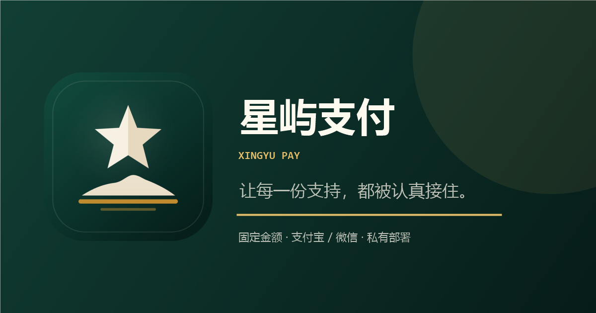

# 星屿支付 / Xingyu Pay

固定金额、支付宝与微信双渠道、邮件审核、支持记录和 OpenAPI 的个人收款系统。前端与后端分离，适合部署在自己的服务器或宝塔面板。



## 功能

- 固定金额商品，前端只能选择页面提供的金额
- 支付宝：服务端锁定金额，拉起支付宝付款页
- 微信：`qr/wechat/{金额}/1.png`、`2.png` 对应金额二维码
- 下单后邮件通知管理员审核
- 审核链接一次性 token，30 分钟有效
- 审核通过必须输入实际到账金额，金额不一致直接拒绝
- 审核通过/驳回只允许 POST
- 公开支持记录脱敏
- 管理端统计使用 `X-Admin-Token` 请求头
- 前后端分开部署，改页面不需要重新打包 JAR
- 响应式首页、支持中心、支付页、记录页和帮助中心
- 完整站点图标、PWA manifest 和 Open Graph 封面

## 界面

```text
frontend/templates/     Thymeleaf 页面
frontend/static/css/    全站视觉系统
frontend/static/assets/ 图标、二维码备注示例、JS
frontend/static/site.webmanifest
```

品牌图标全部为仓库内自有 SVG/PNG 资源：

```text
frontend/static/assets/images/brand-mark.svg
frontend/static/assets/images/favicon.svg
frontend/static/assets/images/favicon.ico
frontend/static/assets/images/apple-touch-icon.png
frontend/static/assets/images/icon-96.png
frontend/static/assets/images/icon-192.png
frontend/static/assets/images/icon-256.png
frontend/static/assets/images/icon-384.png
frontend/static/assets/images/icon-512.png
frontend/static/assets/images/maskable-512.png
frontend/static/assets/images/og-cover.png
```

## 安全设计

- 金额只从服务端商品配置读取，忽略浏览器提交的金额
- `openAlipay` 只接受 32 位十六进制订单 ID，金额从数据库读取
- `GET /review` 只展示，不修改订单
- `POST /order/pass` 校验订单状态和实际到账金额
- `POST /order/back` 只允许待支付/已扫码状态
- 公开列表只返回成功订单，隐藏邮箱、附言、支付标识
- 管理员 token 使用常量时间比较，空 token 不会通过
- 只信任 Nginx 写入的 `X-Real-IP`
- 关闭 MyBatis SQL 明文日志
- 统一安全响应头：CSP、X-Frame-Options、nosniff、Referrer-Policy、Permissions-Policy
- 生产环境启动时检查 `ADMIN_TOKEN`、`OPENAPI_SECRET`、`DB_PASSWORD` 是否为占位符或过短
- OpenAPI 校验时间戳、签名格式、订单号格式、金额范围和回调地址

## 技术栈

- Java 8
- Spring Boot 2.3
- Thymeleaf
- MyBatis-Plus
- MySQL 5.7+ / 8.0
- Redis 6+
- Nginx
- 原生 CSS + Vue 3

## 目录

```text
src/                    后端源码
config/                 生产/本地配置
frontend/templates/     Thymeleaf 页面
frontend/static/        CSS / JS / 图标 / manifest
deploy/                 systemd、Nginx、脚本、建表 SQL
deploy/baota/           宝塔专用 Nginx、systemd、env 模板
docs/                   部署、宝塔教程、安全、开源检查
qr/                     固定金额收款二维码
```

## 本地构建

```bash
mvn clean package -DskipTests
```

运行：

```bash
export FRONTEND_DIR="$PWD/frontend"
java -jar target/xingyu-pay-backend.jar \
  --spring.profiles.active=prod \
  --spring.config.additional-location=file:./config/
```

本地 H2 演示：

```bash
java -jar target/xingyu-pay-backend.jar \
  --spring.profiles.active=local \
  --spring.config.additional-location=file:./config/ \
  --spring.datasource.url='jdbc:h2:mem:pay;MODE=MySQL;DATABASE_TO_LOWER=TRUE;DB_CLOSE_DELAY=-1'
```

## 配置

复制 `.env.example` 为 `.env`，填写自己的数据库、Redis、邮箱、管理员 token：

```bash
cp .env.example .env
chmod 600 .env
```

必改项：

```text
DB_PASSWORD
REDIS_PASSWORD
ADMIN_TOKEN
OPENAPI_SECRET
MAIL_USERNAME
MAIL_PASSWORD
MAIL_FROM
MAIL_TO
SUPPORT_MAIL
ALIPAY_USER_ID
```

`ADMIN_TOKEN` 和 `OPENAPI_SECRET` 请各自生成 64 位随机十六进制，不要相同：

```bash
openssl rand -hex 32
```

## 二维码

```text
qr/wechat/1.00/1.png
qr/wechat/1.00/2.png
qr/wechat/5.00/1.png
qr/wechat/5.00/2.png
...
```

金额必须与 `config/application-prod.yml` 里的 `products[].money` 一致。

仓库中的二维码属于公开收款入口；部署自己的实例前，请替换为自己的收款码并确认允许公开。

## 邮件审核流程

1. 用户下单，后端生成订单和一次性审核 token。
2. 管理员收到邮件，邮件里只有“打开审核页”链接。
3. 打开 `review?id=...&t=...`，页面只展示订单。
4. 管理员核对支付宝/微信实际到账金额。
5. 输入到账金额并通过；金额不一致会被拒绝。
6. token 使用一次后删除。

## 部署

- 通用部署：`docs/DEPLOY.md`
- 宝塔面板完整教程：`docs/BAOTA_DEPLOY.md`
- 宝塔模板：`deploy/baota/`

## Docker

```bash
cp .env.example .env
docker compose up -d --build
```

## 测试

```bash
mvn clean test package
```

## 开源检查

见 `docs/OPEN_SOURCE_CHECK.md`。

仓库不包含 `.env`、JAR、日志、数据库、旧版回滚包。真实收款二维码按仓库所有者的决定公开展示。

## 许可证

MIT License。见 `LICENSE` 和 `NOTICE`。
