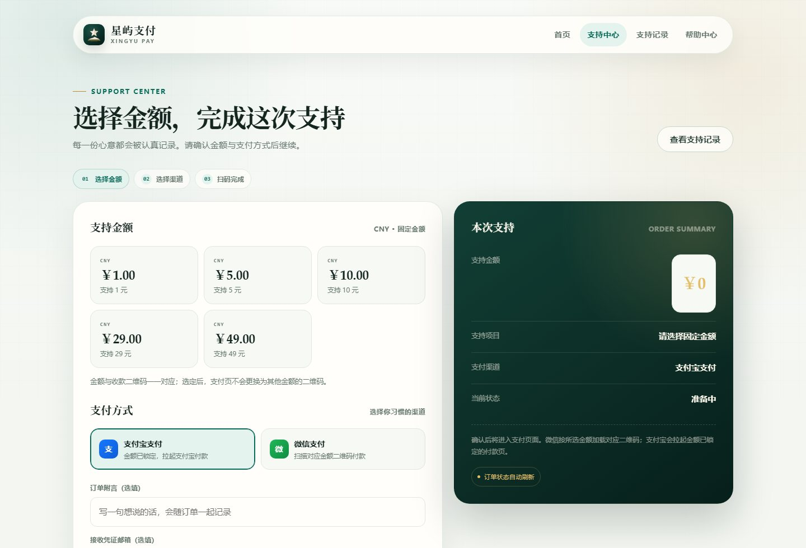
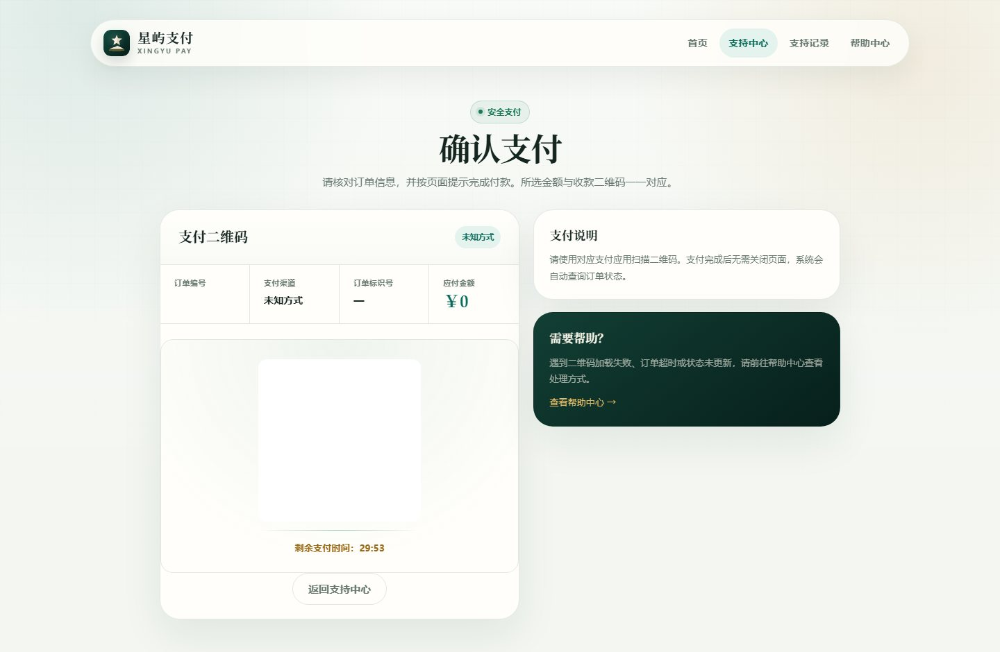
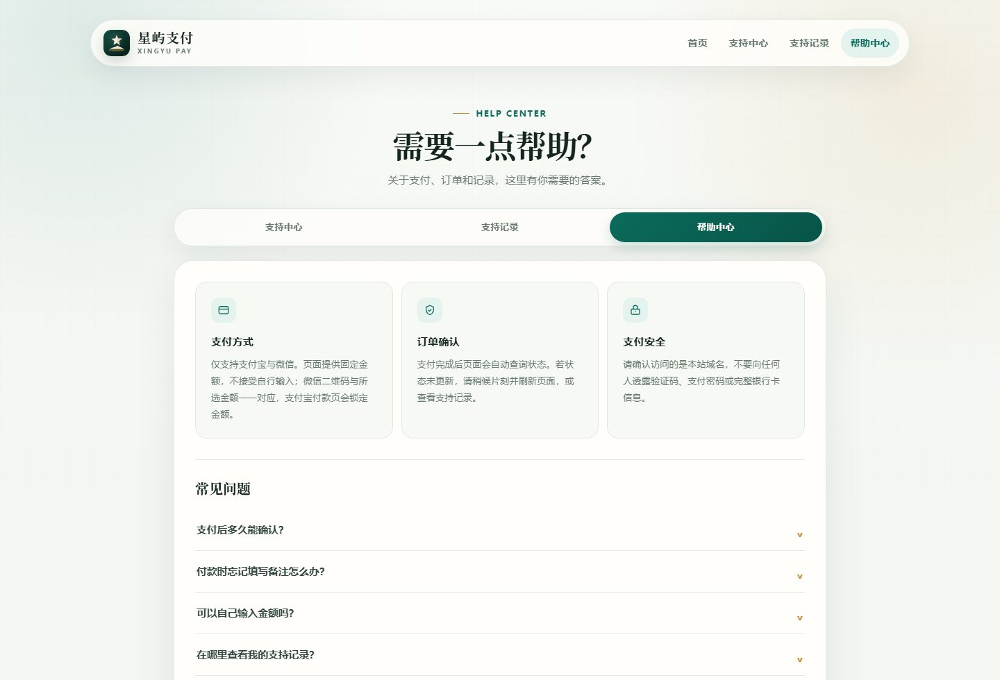

<div align="center">


# 星屿支付 · Xingyu Pay

**固定金额 · 支付宝 / 微信 · 邮件审核 · 前后端分离**

把个人收款做成一个体面、可控、属于自己的页面。

[](LICENSE)
[](pom.xml)
[](pom.xml)
[](deploy/database.sql)
[](docs/BAOTA_DEPLOY.md)

[界面预览](#界面预览) · [功能](#功能) · [快速开始](#快速开始) · [宝塔部署](#宝塔面板部署) · [安全设计](#安全设计) · [OpenAPI](OPEN_API.md)

</div>

---

## 界面预览

| 首页 | 支持中心 |
| :---: | :---: |
|  |  |
| **确认支付** | **帮助中心** |
|  |  |

> 深墨绿、象牙白与黄铜金组成的视觉系统；桌面与移动端自适应，支持 `prefers-reduced-motion`。

## 功能

| 能力 | 说明 |
| --- | --- |
| 固定金额 | 金额由服务端配置下发，支付页不接受用户输入 |
| 支付宝 | 服务端锁定金额后拉起支付宝付款页 |
| 微信 | 按金额匹配 `qr/wechat/{金额}/1.png` 或 `2.png` |
| 邮件审核 | 下单后通知管理员；审核链接一次性、30 分钟有效 |
| 金额核对 | 审核时必须填写实际到账金额，不一致直接拒绝 |
| 支持记录 | 公开列表只展示成功订单，并做脱敏处理 |
| 前后端分离 | 改页面只需要替换 `templates/` 与 `static/`，不用重打包 JAR |
| 品牌资源 | 自有 SVG/PNG 图标、PWA manifest、Open Graph 封面 |
| OpenAPI | 签名校验、时间戳窗口、金额与回调地址校验 |

## 技术栈

- Java 8
- Spring Boot 2.3 + Thymeleaf
- MyBatis-Plus
- MySQL 5.7+ / 8.0
- Redis 6+
- Nginx
- 原生 CSS + Vue 3（浏览器端模板编译）

## 目录结构

```text
src/                      后端源码
config/                   生产 / 本地配置
frontend/
├── templates/            Thymeleaf 页面
└── static/
    ├── css/              全站视觉系统
    ├── assets/           JS、图标、二维码备注示例
    └── site.webmanifest
deploy/
├── baota/                宝塔专用 Nginx、systemd、env 模板
├── database.sql          建表 SQL
├── nginx-proxy.conf.example
└── start.sh / stop.sh / check-env.sh
docs/
├── BAOTA_DEPLOY.md       宝塔面板完整教程
├── DEPLOY.md             通用部署
├── SECURITY.md           安全说明
├── OPEN_SOURCE_CHECK.md  开源检查清单
└── screenshots/          README 截图
qr/                       固定金额收款二维码
```

## 快速开始

### 1. 构建

```bash
mvn clean package -DskipTests
```

产物：

```text
target/xingyu-pay-backend.jar
```

### 2. 配置

```bash
cp .env.example .env
chmod 600 .env
```

至少修改：

```text
DB_URL / DB_USERNAME / DB_PASSWORD
REDIS_HOST / REDIS_PASSWORD
SITE_URL
ADMIN_TOKEN
OPENAPI_SECRET
MAIL_USERNAME / MAIL_PASSWORD / MAIL_FROM / MAIL_TO
ALIPAY_USER_ID
FRONTEND_DIR
QR_DIR
```

两个密钥分别生成，且不能相同：

```bash
openssl rand -hex 32
```

### 3. 启动

```bash
export FRONTEND_DIR="$PWD/frontend"
java -jar target/xingyu-pay-backend.jar \
  --spring.profiles.active=prod \
  --spring.config.additional-location=file:./config/
```

默认监听 `127.0.0.1:8889`，由 Nginx 对外提供 HTTPS。

### 4. 本地演示（H2）

```bash
java -jar target/xingyu-pay-backend.jar \
  --spring.profiles.active=local \
  --spring.config.additional-location=file:./config/ \
  --server.port=8899
```

## 宝塔面板部署

完整步骤见 **[docs/BAOTA_DEPLOY.md](docs/BAOTA_DEPLOY.md)**，包含 DNS、站点、MySQL、Redis、`.env`、systemd、Nginx、SSL、防火墙、上线验证与回滚。

最短路径：

```text
1. 宝塔安装 Nginx / MySQL / Redis / JDK 1.8
2. 创建站点 pay.example.com，根目录放 frontend 内容
3. 后端放到独立目录，上传 JAR、config、qr、脚本
4. 写入 .env，chmod 600
5. 安装 systemd 服务并启动
6. Nginx 反向代理到 127.0.0.1:8889
7. 申请 SSL，强制 HTTPS
8. 验证首页、支付页、审核页和二维码
```

宝塔模板：

```text
deploy/baota/nginx-site.conf.example
deploy/baota/paypro.service.example
deploy/baota/env.example
```

> 前端目录与后端目录必须分开；站点根目录不要放 `.env`、JAR、日志或数据库备份。

## 配置说明

| 变量 | 必填 | 说明 |
| :--- | :---: | :--- |
| `SITE_URL` | 是 | 对外 HTTPS 地址 |
| `DB_URL` | 是 | MySQL 连接串 |
| `DB_USERNAME` / `DB_PASSWORD` | 是 | 数据库账号 |
| `REDIS_HOST` / `REDIS_PORT` | 是 | Redis 地址 |
| `ADMIN_TOKEN` | 是 | 管理端请求头 token，至少 32 位 |
| `OPENAPI_SECRET` | 是 | OpenAPI 签名密钥，至少 32 位 |
| `MAIL_*` | 是 | SMTP 账号与授权码 |
| `ALIPAY_USER_ID` | 是 | 支付宝收款账号 UID（通常 `2088` 开头） |
| `ALIPAY_CUSTOM_QR_URL` | 否 | 自定义收款码链接 |
| `FRONTEND_DIR` | 是 | 包含 `templates/` 与 `static/` 的目录 |
| `QR_DIR` | 是 | 金额二维码目录 |
| `JVM_HEAP_SIZE` | 否 | 默认 `-Xms256m -Xmx512m` |

生产环境启动时会检查占位符、短密钥和相同密钥，不满足会直接失败。

## 二维码

```text
qr/
├── alipay/
│   └── custom.png
└── wechat/
    ├── 1.00/1.png
    ├── 1.00/2.png
    ├── 5.00/1.png
    └── 5.00/2.png
```

- 金额必须与 `config/application-prod.yml` 的 `products[].money` 一致。
- 支付页展示哪一张，就严格按该金额与渠道支付。
- 仓库中的二维码属于公开收款入口；部署自己的实例前请替换为自己的收款码。

## 邮件审核流程

```text
用户下单
   ↓
后端生成订单 + 一次性 token
   ↓
管理员收到审核邮件
   ↓
打开 review?id=...&t=...
   ↓
核对实际到账金额
   ↓
通过 / 驳回（仅 POST）
   ↓
token 立即失效
```

审核通过必须输入实际到账金额；金额不一致会被拒绝。审核链接 30 分钟有效。

## 安全设计

- 支付金额只从服务端商品配置读取，忽略浏览器提交值
- `openAlipay` 只接受 32 位十六进制订单 ID，金额从数据库读取
- `GET /review` 只读展示，修改订单只允许 `POST`
- 管理员 token 常量时间比较；空 token 与短 token 直接拒绝
- 公开列表只返回成功订单，隐藏邮箱、附言、支付标识
- 只信任 Nginx 写入的 `X-Real-IP`
- 统一响应头：CSP、`X-Frame-Options: DENY`、`nosniff`、Referrer-Policy、Permissions-Policy
- 关闭 MyBatis SQL 明文日志与 Spring 错误堆栈输出
- Nginx 隐藏版本号，TLS 仅 1.2/1.3，启用 HSTS
- systemd 使用 `NoNewPrivileges`、`ProtectSystem`、`PrivateTmp` 等限制

更多内容见 **[SECURITY.md](SECURITY.md)** 与 **[docs/SECURITY.md](docs/SECURITY.md)**。

## OpenAPI

签名、请求字段、返回结构与错误码见 **[OPEN_API.md](OPEN_API.md)**。

## Docker

```bash
cp .env.example .env
docker compose up -d --build
```

## 测试

```bash
mvn clean test package
```

当前测试覆盖签名工具、二维码金额解析、订单服务与邮件模板。

## 开源检查

见 **[docs/OPEN_SOURCE_CHECK.md](docs/OPEN_SOURCE_CHECK.md)**。

仓库不包含：

```text
.env
*.jar
target/
logs/
data/
*.pem / *.key
```

`qr/` 由仓库所有者决定公开，用于展示真实固定金额收款入口。

## 许可证

[MIT License](LICENSE) © 2026 xuanxuan205

上游项目名称与商标归各自所有者，详见 [NOTICE](NOTICE)。